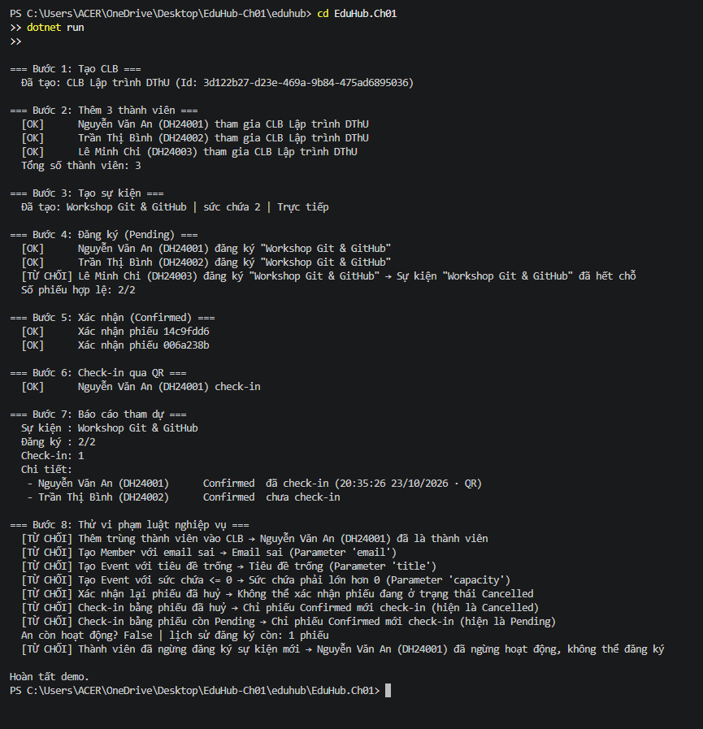

# Câu 3, 4 bài tập chương 1

## Quy tắc nghiệp vụ (nằm trong entity)

| Entity | Quy tắc |
|---|---|
| Member | Tên không trống; email hợp lệ; MSSV không trống; `Deactivate()` giữ nguyên lịch sử |
| Club | `AddMember()` chặn trùng và chặn thành viên đã ngừng hoạt động |
| Event | Tiêu đề không trống; `Capacity > 0`; phải gắn `ClubId` |
| Registration | Chỉ tạo khi thành viên Active và sự kiện còn chỗ; chỉ `Pending` mới `Confirm()` |
| CheckIn | Chỉ phiếu `Confirmed` mới check-in |

## Ảnh chụp kết quả

